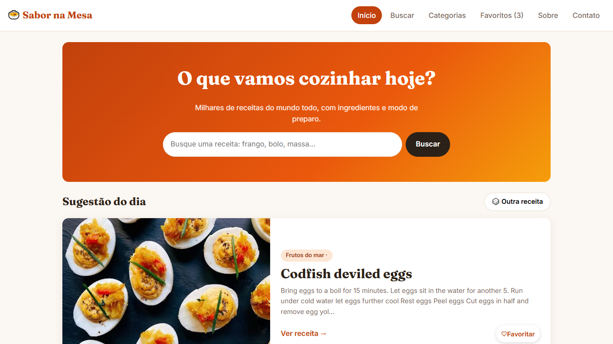
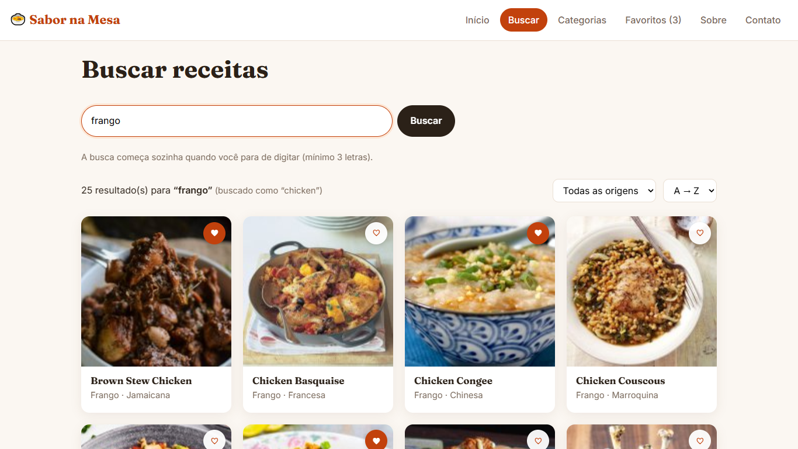
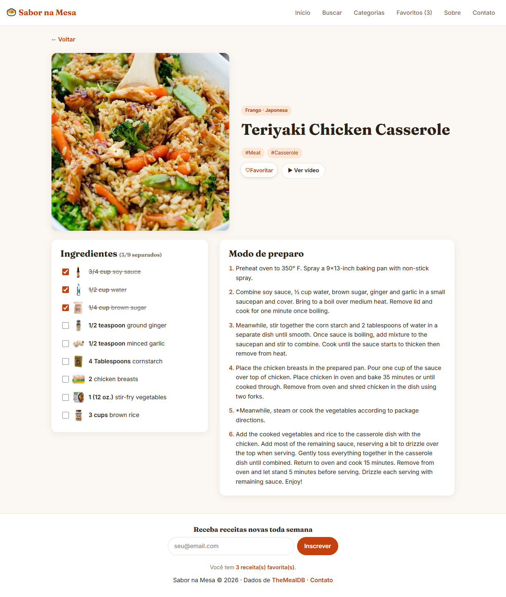
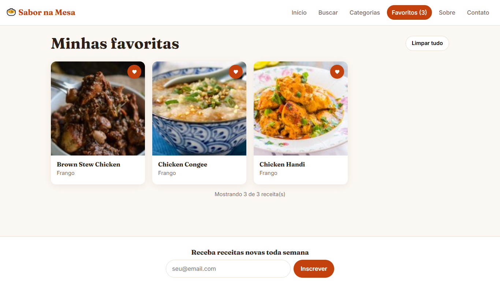
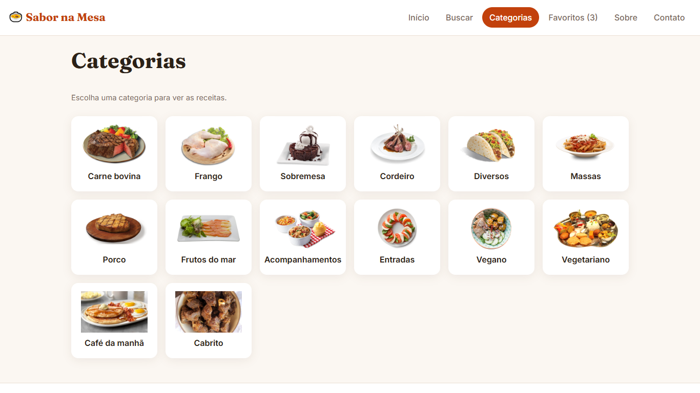
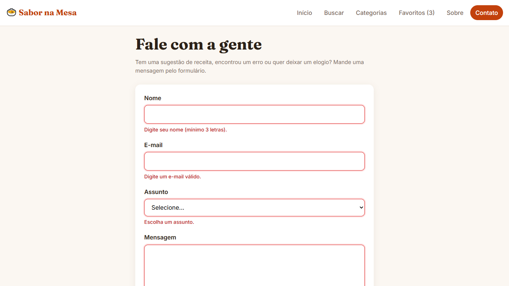

# 🍲 Sabor na Mesa

Aplicação web de receitas desenvolvida em **React + TypeScript** como Trabalho Final (AV2) da disciplina **Front-end Frameworks** — Ciência da Computação.

Consome a API pública e gratuita **[TheMealDB](https://www.themealdb.com/api.php)** para buscar receitas, categorias, ingredientes e modo de preparo.

🔗 **Deploy:** _cole aqui o link da Vercel_

---

## 👥 Integrantes e componentes

| Integrante | Componentes desenvolvidos | Destaques técnicos |
|---|---|---|
| Leonardo Santana | `Navbar`, `Footer` | Menu mobile com `useState`; newsletter com validação de e-mail e contador de favoritos (`useFavorites`) |
| Luis Guilherme | `SearchBar`, `FavoriteButton` | `useRef` (foco automático) e busca enquanto digita com o custom hook `useDebounce`; favoritar via Context |
| Zion Falcão | `RecipeCard`, `RecipeGrid` | Paginação "Carregar mais" com `useState` + `useEffect` |
| Carlos Saulo | `CategoryCard`, `IngredientList` | Lista de ingredientes marcáveis com `useState` |
| Ramon Frota | `Loader`, `ErrorMessage` | Loader com atraso (timer no `useEffect`); erro com contagem regressiva e nova tentativa automática |

Componente extra do grupo: `ContactForm` (página Contato) — formulário controlado e tipado, com validação e `useRef` para focar o primeiro campo com erro.

---

## ✅ Requisitos atendidos

| Requisito | Como foi atendido |
|---|---|
| **TypeScript** | Todo o projeto em `.ts` / `.tsx`, com tipos em `src/types.ts` |
| **≥ 8 componentes funcionais** | 11 componentes em `src/components/` |
| **≥ 5 páginas** | 8 páginas + 404 em `src/pages/` (Início, Buscar, Categorias, Receitas da categoria, Detalhes, Favoritos, Sobre, Contato) |
| **≥ 4 hooks diferentes** | `useState`, `useEffect`, `useContext`, `useReducer`, `useRef`, `useMemo`, `useCallback` + hooks do React Router (`useParams`, `useNavigate`, `useSearchParams`, `useLocation`) + **custom hooks** `useFetch`, `useFavorites`, `useDebounce` e `useLocalStorage` |
| **Roteamento** | React Router DOM, incluindo rotas dinâmicas (`/receita/:id`, `/categorias/:name`) |
| **API (extra)** | Integração com a API REST TheMealDB |

### Onde cada hook é usado

- **useState** — `SearchBar`, `Navbar`, `Footer`, `RecipeGrid`, `IngredientList`, `Loader`, `ErrorMessage`, `ContactForm`, `Search`
- **useEffect** — `useFetch` (requisições), `Loader` e `ErrorMessage` (timers), `RecipeGrid` (volta à 1ª página), `App` (scroll ao topo)
- **useContext** — `useFavorites` acessa o `FavoritesContext` em qualquer componente
- **useReducer** — `FavoritesContext` gerencia os favoritos com ações `ADD`, `REMOVE` e `CLEAR`
- **useRef** — `SearchBar` (foco automático) e `ContactForm` (foca o primeiro campo com erro)
- **useMemo** — `Search` (filtro e ordenação) e `RecipeDetails` (ingredientes e passos)
- **useCallback** — `useFetch` (função `refetch`)
- **Custom hooks**
  - `useFetch` — busca dados da API com loading, erro e cache
  - `useFavorites` — acessa os favoritos globais
  - `useDebounce` — espera o usuário parar de digitar antes de buscar
  - `useLocalStorage` — salva os favoritos no navegador

---

## 📁 Estrutura

```
src/
├── components/     # 11 componentes reutilizáveis
├── context/        # FavoritesContext (estado global com useReducer)
├── hooks/          # custom hooks: useFetch, useDebounce, useLocalStorage
├── pages/          # páginas da aplicação
├── services/api.ts # endpoints da API e funções auxiliares
├── types.ts        # interfaces TypeScript
├── App.tsx         # rotas
└── main.tsx        # ponto de entrada
```

---

## ▶️ Como rodar

Pré-requisito: [Node.js](https://nodejs.org) 18 ou superior.

```bash
git clone https://github.com/SEU-USUARIO/sabor-na-mesa.git
cd sabor-na-mesa
npm install
npm run dev
```

Acesse `http://localhost:5173`.

Para gerar a versão de produção: `npm run build`.

> A API só tem receitas em inglês, mas a busca aceita português: o site traduz o termo com um dicionário próprio (`toEnglishSearch` em `src/services/api.ts`). Tente: `frango`, `bolo de chocolate`, `massa`, `sopa`.

---

## 🖼️ Telas

| Início | Busca |
|---|---|
|  |  |

| Detalhes da receita | Favoritos |
|---|---|
|  |  |

| Categorias | Contato (validação do formulário) |
|---|---|
|  |  |
